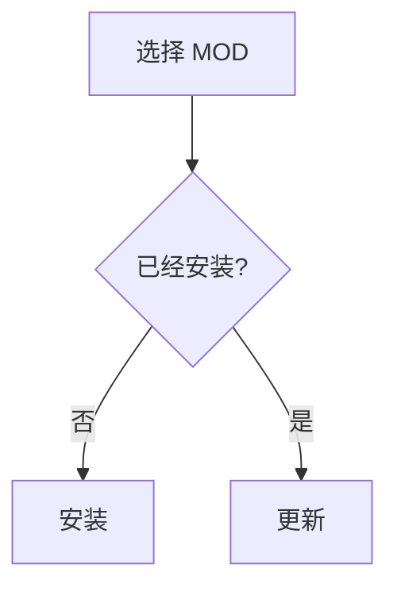

# OC2 MOD Manager 仓库源配置指南

本文面向《胡闹厨房 2》MOD 作者和仓库源维护者，说明如何制作、分享和维护管理器能够读取的 TOML 仓库源。

一个 MOD 仓库条目通过 `provider`、`username`、`repository` 指定 GitHub 或 Gitee 项目，可选择下载 Release 资产或指定分支中的单个文件。仓库源文件可以包含多个 MOD 仓库，也可以引用其他仓库源，组织成父源和子源。具体 MOD 仓库不填写 `url`；仓库源和加速来源继续使用 `url` 指向文件。

## 仓库源和导出配置的区别

仓库源是一个供程序在线读取的 TOML 文件，可以包含一个或多个 `[[repositories]]` 条目，也可以通过 `[[repository_sources]]` 条目继续声明其他仓库源。程序读取仓库源后，会保存并刷新其中的仓库源，再读取这些子仓库源中的仓库。

```toml
[[repositories]]
provider = "github"
username = "example"
repository = "my-mod"
download_mode = "release"
region = "international"
channel = "all"
install_target = "BepInEx/plugins"
plugin_guid = "com.example.my-mod"
local_product_name = "My MOD"
local_original_filename = "MyMod.dll"
version_regex = ''
max_release_count = 10
download_threads = 16
enabled = true

name_i18n.zh-CN = "我的 MOD"
name_i18n.en = "My MOD"
group_i18n.zh-CN = "内容拓展"
group_i18n.en = "Content Expansion"
note_i18n.zh-CN = ""
note_i18n.en = ""

[[repositories.asset_rules]]
type = "exact"
value = "MyMod.dll"
```

仓库的 `name_i18n`、`group_i18n`、`note_i18n` 都必须包含 `zh-CN`（`name_i18n.zh-CN` 不能为空）。界面语言缺失时回落到 `zh-CN`；旧的单语 `name` / `group` / `note` 仍可读取，加载时自动折叠进对应的 `zh-CN`，新文件不要再写它们。

若 MOD 文件直接保存在分支中，使用 `repository_file` 模式。管理器根据平台、用户名、仓库名、分支和相对路径生成 Raw 下载地址：

```toml
[[repositories]]
provider = "github"
username = "gua248"
repository = "Overcooked2-ManyRecipes"
download_mode = "repository_file"
branch = "master"
download_threads = 4
file_path = "bin/Release/OC2ManyRecipes.dll"
plugin_guid = "dev.gua.overcooked.manyrecipes"
local_product_name = "OC2ManyRecipes"
local_original_filename = "OC2ManyRecipes.dll"
install_target = "BepInEx/plugins"
enabled = true

name_i18n.zh-CN = "OC2 Many Recipes"
group_i18n.zh-CN = ""
note_i18n.zh-CN = ""
```

GitHub 文件地址按 `https://github.com/{username}/{repository}/raw/refs/heads/{branch}/{file_path}` 拼接，Gitee 按 `https://gitee.com/{username}/{repository}/raw/{branch}/{file_path}` 拼接。文件模式不读取 Release，也不使用 Release 频道或资产匹配规则；安装文件名取相对路径末尾的文件名。

两种下载模式都可以填写 GUID、产品名称和原始文件名，供管理器识别已经安装的本地 MOD。仓库文件模式没有 Release 版本记录，因此不会检测 Release 更新；在 MOD 管理页显示“不是 Release 资产, 无法检测更新”。

仓库源不需要，也不应该添加下面这些导出配置包字段：

- `format`
- `schema_version`
- `exported_at`

这些字段只属于软件“导出配置”生成的完整配置包。完整配置包用于在另一台管理器中导入，不能直接替代仓库源文件。

仓库源可以使用 `.toml` 或 `.oc2repo.toml` 扩展名，例如 `repositories.toml` 或 `my-repositories.oc2repo.toml`。文件必须使用 UTF-8 编码；对外分享时，入口地址必须能够通过公开的 HTTP 或 HTTPS 地址返回 TOML 原文。

### 在仓库源中声明其他仓库源

仓库源文件可以使用 `[[repository_sources]]` 声明子仓库源。子仓库源会在父仓库源刷新成功后自动加入仓库管理，并继续递归刷新：

```toml
[[repository_sources]]
id = "azhe-hostutilities"
url = "repositories-azhe-hostutilities.toml"
builtin = true

[repository_sources.nickname_i18n]
zh-CN = "阿哲 - 街机MOD - 小红书 @Azhe是阿哲 - ID:5566308341"
zh-TW = "阿哲 - 街機MOD - 小红书 @Azhe是阿哲 - ID:5566308341"
en = "Azhe - HostUtilities MOD - RedNote @Azhe是阿哲 - ID:5566308341"
ko = "Azhe - 아케이드 MOD - RedNote @Azhe是阿哲 - ID:5566308341"
ja = "Azhe - アーケード MOD - RedNote @Azhe是阿哲 - ID:5566308341"

[[repository_sources]]
id = "gua"
url = "https://gitee.com/example/mod-releases/raw/main/repositories-gua.toml"

[repository_sources.nickname_i18n]
zh-CN = "G_U_A"
```

示例中的 `example` 是占位符，请替换为实际的仓库所有者。多语言表属于紧邻它之前的那个 `[[repository_sources]]`；声明下一个源时，需要重新写 `[[repository_sources]]`。

### 仓库源字段

| 字段 | 是否必填 | 说明 |
| --- | --- | --- |
| `id` | 是 | 源的唯一标识，同一源文件中不能重复。建议使用字母、数字、点、短横线和下划线，首字符使用字母或数字。 |
| `nickname_i18n` | 是 | 多语言昵称表，必须包含非空的 `zh-CN`。支持 `zh-CN`、`zh-TW`、`en`、`ko`、`ja`。 |
| `url` | 是 | 完整 HTTP(S) 直链，或相对于当前源所在仓库的文件路径。 |
| `region` | 否 | `chinese_mainland` 仅中国大陆，`international` 仅非中国大陆；省略时对所有地区显示。 |
| `builtin` | 否 | 子源是否继承父源的内置保护，普通自定义源通常省略。使用布尔值 `true` / `false`。 |

`nickname_i18n` 根据当前界面语言选择昵称；当前语言缺失或为空时回落到 `zh-CN`，再回落到表里第一个非空值。`zh-CN` 是强制兜底值：它缺失或为空时整个源会被判为无效 —— 与仓库的 `name_i18n`、`group_i18n`、`note_i18n` 规则完全一致，不会出现「翻译表没有当前语言、单语字段又是另一种语言」这种两边都不是的状态。旧的单语 `nickname` 仍可读取，加载时会自动折叠进 `nickname_i18n.zh-CN`，但新文件不要再写它。

`region` 根据电脑地区设置筛选源，与界面语言无关：只想翻译同一个源的标题时，添加多语言表即可，不需要为了翻译重复声明源。同一 URL 可以按不同地区声明多个源，但每个源必须使用不同的 `id`。

`builtin` 不能把普通自定义源变成受保护的内置源。内置父源的子源默认继承保护；子源显式填写 `builtin = false` 后，该子源及其后代不再继承保护，后代即使填写 `builtin = true` 也不能重新开启保护。兼容已有的 `"true"` / `"false"` 字符串写法，但新文件建议使用布尔值。

嵌套源不需要填写 `parent_id`，管理器会根据声明它的父源维护父子关系。源文件成功解析后，管理器会先展示其中的仓库和子源，再分别刷新 Release 和子源内容；某一项失败不会阻止其他项展示。如果父源移除了某个子源，下次刷新也会移除该子源及其下级内容。不要让子源引用自身或循环引用父源。

### 子源地址和相对路径

`url` 填写完整 HTTP(S) 地址时，管理器直接请求该地址。填写文件路径时，按以下规则解析：

| `url` 写法 | 解析位置 |
| --- | --- |
| `mods/child.toml` | GitHub/Gitee raw 地址所属仓库的当前分支根目录。 |
| `./child.toml` | 当前源文件所在目录。 |
| `../shared.toml` | 当前源文件所在目录的上一级，不能越过仓库分支根目录。 |
| `https://example.com/child.toml` | 指定的完整直链。 |

例如，父源地址是 `https://gitee.com/owner/repo/raw/main/config/index.toml`：

- `url = "mods/child.toml"` 对应 `https://gitee.com/owner/repo/raw/main/mods/child.toml`。
- `url = "./child.toml"` 对应 `https://gitee.com/owner/repo/raw/main/config/child.toml`。
- `url = "../shared.toml"` 对应 `https://gitee.com/owner/repo/raw/main/shared.toml`。

GitHub 支持 `/raw/main/`、`/raw/refs/heads/master/` 和 `raw.githubusercontent.com` 形式，路径会保留当前分支或标签。普通 HTTP(S) 文件地址按当前文件目录解析相对路径。完整直链指向另一仓库后，该文件声明的后续子源也从新仓库解析。Raw 链接跳转到 CDN 时仍保留原始仓库和分支作为路径基准。

管理器自带的源也使用相同格式，普通文件路径从其资源根目录解析。维护一组源文件时，可以保留相同目录结构上传到线上，继续使用原来的相对路径；线上源不会通过相对路径读取用户电脑上的文件。

## 如何制作仓库源

### 1. 填写仓库身份

具体 MOD 仓库使用三个必填字段：

- `provider`：托管平台，填写 `github` 或 `gitee`。
- `username`：仓库所属的用户或组织名。
- `repository`：平台上的实际仓库名，不能用 MOD 的显示名称代替。

例如，项目位于 `https://github.com/gua248/Overcooked2-ManyRecipes` 时，填写：

```toml
provider = "github"
username = "gua248"
repository = "Overcooked2-ManyRecipes"
```

管理器按平台自动拼接项目主页：GitHub 使用 `https://github.com/{username}/{repository}`，Gitee 使用 `https://gitee.com/{username}/{repository}`。Release 模式据此请求对应 API；打开发布页时在主页后添加 `/releases`。不要在 `username`、`repository` 中填写完整地址、`/raw` 或 `/releases` 路径，也不要在 `[[repositories]]` 中添加 `url`。

若文件位于分支中，设置 `download_mode = "repository_file"`，并提供 `branch` 和 `file_path`。文件模式只支持具体文件路径，不支持通配符或正则；GitHub Raw 加速从管理器的全局 Raw 加速列表读取。仓库源与加速来源的 `url` 指向文档地址，仍按前述直链和相对路径规则填写。

### 2. 查看要安装的资产文件名

打开 Release，确认真正需要下载的文件名。例如：

- 单个插件：`MyMod.dll`
- 压缩包：`MyMod.zip`
- 带版本号的压缩包：`MyMod_v1.2.3.zip`

然后用资产规则匹配它。规则可以有多个，多个规则之间是“满足任意一个即可”。

```toml
[[repositories.asset_rules]]
type = "exact"
value = "MyMod.dll"

[[repositories.asset_rules]]
type = "exact"
value = "MyMod.zip"
```

### 3. 选择资产规则类型

#### 精确匹配

适合文件名固定的资产，匹配时不区分大小写：

```toml
[[repositories.asset_rules]]
type = "exact"
value = "HostUtilities.zip"
```

#### 通配符匹配

支持 `*` 和 `?`，也不区分大小写：

```toml
[[repositories.asset_rules]]
type = "glob"
value = "HostUtilities_*.zip"
```

#### 正则表达式匹配

使用 Rust 正则表达式语法。需要匹配整个文件名时，建议加上 `^` 和 `$`：

```toml
[[repositories.asset_rules]]
type = "regex"
value = '^BepInEx\.ConfigurationManager_BepInEx5_v\d+\.\d+\.zip$'
```

单引号 TOML 字符串适合保存正则表达式，因为反斜杠不需要再次转义。正则表达式必须能够被 Rust `regex` 库解析，不能使用环视或反向引用等不支持的语法。

### 4. 设置安装目录

`install_target` 是相对于游戏目录的安装路径。在线安装以此字段为准，目标目录不存在时会创建；请根据发布文件的目录结构填写：

```toml
install_target = "BepInEx/plugins"
```

如果压缩包本身已经包含 `BepInEx` 顶层目录，可以设置为空字符串，让管理器按照压缩包内部结构安装：

```toml
install_target = ""
```

单独发布 DLL 时，通常填写 `BepInEx/plugins`。不要填写绝对路径，也不要使用 `..` 跳出游戏目录。

DLL、纯 DLL ZIP 和单个普通文件夹直接放入配置目录，保留 ZIP 内的普通文件夹名。例如 ZIP 只有 `OC2HostUtilities/` 文件夹，配置 `BepInEx/plugins` 后会得到 `BepInEx/plugins/OC2HostUtilities/`；不要在配置路径中再重复填写普通文件夹名。

混合 ZIP (文件夹和文件混合的ZIP) 会在配置路径下创建压缩包同名目录（去除 `.zip`），再将所有文件和目录按原结构放进去。例如 `HostUtilities.zip` 内有 `OCHostUtilities` 文件夹、DLL 和 README，配置 `BepInEx/plugins` 后全部放入 `BepInEx/plugins/HostUtilities/`。配置路径已指向同名包目录时 (`BepInEx/plugins/HostUtilities/`) 直接复用，避免多套一层。本地混合 ZIP 同样放入 `BepInEx/plugins/<ZIP 名称>/`。

ZIP 顶层仅有 `BepInEx/` 或 `plugins/` 时，管理器会合并其内容并替换同名文件，保留其他文件。`BepInEx/` 格式可使用空路径；`plugins/` 格式通常应配置 `BepInEx`。空路径始终表示游戏根目录，因此 `plugins/` 格式配空路径会安装到游戏根目录的 `plugins/`。目标已包含特殊目录前缀时会去除重复前缀，缺失目录自动创建；特殊目录旁有 README 等条目时，按普通混合 ZIP 完整安装。

在线重装或升级会先下载、校验新文件，再将旧安装清单对应的完整 MOD 包移入回收站（含禁用文件），最后安装新版。安装失败时尝试恢复旧包；其他包仍使用的共享文件不会移入回收站。

### 5. 填写本地 MOD 识别信息

Release 与仓库文件两种模式都使用 GUID、DLL 的 `ProductName` 和 `OriginalFilename` 将本地 MOD 绑定到仓库，三项中任意一项匹配即可；填写版本号正则时，还需满足版本条件。建议按实际 DLL 信息填写，不根据下载地址猜测：

```toml
plugin_guid = "com.example.my-mod"
local_product_name = "My MOD"
local_original_filename = "MyMod.dll"
```

如果插件没有 BepInEx GUID，保留 `plugin_guid = ""`，并至少填写 DLL 的产品名称或原始文件名。`plugin_guid` 负责识别本地插件，`asset_rules` 负责选择 Release 下载文件；仓库文件模式用 `file_path` 指定文件，不能用识别字段替代文件路径。

本地绑定不等于可以检测更新。只有 Release 模式会比较已安装版本与 Release 版本；仓库文件模式可以显示来源和识别信息，但不会请求 Release，也不会据此显示“最新版”或“有更新”。

### 6. 按当前 MOD 下载渠道展示仓库

每个 `[[repositories]]` 都可以填写 `region`，用法与 `[[repository_sources]]` 相同：

| 配置 | 展示渠道 |
| --- | --- |
| `region = "chinese_mainland"` | 仅中国大陆。 |
| `region = "international"` | 仅非中国大陆。 |
| 省略 `region` 或填写 `region = ""` | 所有地区。 |

管理器按照电脑地区设置选择当前 MOD 下载渠道，切换界面语言不会改变渠道。仓库必须同时满足自身和所属源的地区限制才会显示；例如，中国大陆源下的 `region = "international"` 仓库不会显示。想在同一源中提供国内和国际两组仓库时，源本身不要限定地区，再为各个仓库分别填写 `region`。

此字段控制仓库卡片展示、刷新、仓库统计、在线更新绑定和配置导出；不符合当前渠道的仓库不会参与这些操作，也不会删除已经安装的本地 MOD。修改仓库时，可以在二级菜单的“适用地区”中选择“中国大陆地区”“国际地区”或“全部地区”，新建仓库默认选择“全部地区”。

同名、同一 `provider` / `username` / `repository` 的仓库可以使用不同 `region` 分别声明，导入时不会因名称相同而互相覆盖。仓库字段写在所属 `[[repositories]]` 下，并放在 `name_i18n`、`group_i18n` 等子表之前。

### 7. 区分版本和限制 Release 数量

`channel` 根据 Release 是否标记为预发布选择版本：`all` 同时获取正式发布和预发布，`stable` 只取正式发布，`beta` 只取预发布。省略时及新建仓库时默认使用 `all`；草稿 Release 不会使用。该字段只影响 Release 模式，不用于仓库文件下载。

如果多个仓库使用同一 GUID，但对应不同版本系列，可以用 `version_regex` 进一步限制本地绑定。例如，只允许三段数字版本绑定：

```toml
version_regex = '^\d+\.\d+\.\d+$'
max_release_count = 10
```

填写正则后，本地版本必须匹配它，并且 GUID、产品名称、原始文件名三项中至少有一项匹配，才能绑定此仓库。正则为空或省略时，不额外限制版本格式。单引号可以避免反斜杠转义；不要仅通过版本位数猜测稳定版或测试版，应按自己实际的版本命名规则填写。

`max_release_count` 是当前仓库的配置，默认 10，可填写 1 到 100。每个 `[[repositories]]` 可以设置不同的数量，不会改变其他仓库的设置。

## 仓库源完整示例

下面的示例展示了分组、多语言名称、多语言简介、Markdown 简介和正则资产规则：

```toml
[[repositories]]
provider = "github"
username = "BepInEx"
repository = "BepInEx.ConfigurationManager"
download_mode = "release"
channel = "all"
install_target = ""
plugin_guid = "com.bepis.bepinex.configurationmanager"
local_product_name = "BepInEx.ConfigurationManager"
local_original_filename = "ConfigurationManager.dll"
max_release_count = 10
download_threads = 32
enabled = true

name_i18n.zh-CN = "BepInEx 配置管理器"
name_i18n.zh-TW = "BepInEx 設定管理器"
name_i18n.en = "BepInEx Configuration Manager"
name_i18n.ko = "BepInEx 구성 관리자"
group_i18n.zh-CN = "前置必装"
group_i18n.zh-TW = "前置必裝"
group_i18n.en = "Required Prerequisites"
group_i18n.ko = "필수 선행 항목"
# 多行文本用三引号；缩进与换行会原样保留
note_i18n.zh-CN = """
此模组用于管理《主机实用MOD》等MOD创建的配置，其默认打开的快捷键是 F1，但可能经由《主机实用MOD》自动修改为 P。
"""
note_i18n.zh-TW = """
此模組用於管理《主機實用MOD》等MOD建立的設定，預設開啟快捷鍵為 F1，但可能會由《主機實用MOD》自動修改為 P。
"""
note_i18n.en = """
This mod is used to manage configurations created by mods such as HostUtilities. Its default hotkey is F1, but HostUtilities may automatically change it to P.
"""
note_i18n.ko = """
이 모드는 《HostUtilities》와 같은 MOD에서 생성한 설정을 관리하는 데 사용됩니다. 기본 단축키는 F1이지만, 《HostUtilities》에 의해 자동으로 P로 변경될 수 있습니다.
"""

[[repositories.asset_rules]]
type = "regex"
value = '^BepInEx\.ConfigurationManager_BepInEx5_v\d+\.\d+\.zip$'

[[repositories]]
provider = "gitee"
username = "ch3ngyz"
repository = "Overcooked-2-HostUtilities-Stable-Releases"
download_mode = "release"
region = "chinese_mainland"
channel = "all"
install_target = "BepInEx/plugins"
plugin_guid = "com.ch3ngyz.plugin.HostUtilities"
local_product_name = "主机实用MOD (街机MOD)"
local_original_filename = "HostUtilities.dll"
max_release_count = 10
download_threads = 1
enabled = true

name_i18n.zh-CN = "主机实用 MOD（街机 MOD）稳定版"
name_i18n.zh-TW = "主機實用 MOD（街機 MOD）穩定版 - Gitee 頻道"
name_i18n.en = "HostUtilities (Arcade MOD) Stable - Gitee"
name_i18n.ko = "HostUtilities (아케이드 MOD) 안정 버전 - Gitee"
group_i18n.zh-CN = "主机实用 MOD 稳定版"
group_i18n.zh-TW = "主機實用 MOD 穩定版"
group_i18n.en = "HostUtilities Stable"
group_i18n.ko = "HostUtilities 안정 버전"
note_i18n.zh-CN = """
提供主机身份下的成员管理、语音聊天、文字聊天、黑名单管理、延迟查看、跳关、重开等提升《胡闹厨房2》游戏体验的辅助功能。
如果下载速度较慢或下载失败，也可以尝试 GitHub 渠道。
"""
note_i18n.zh-TW = """
提供主機身分下的成員管理、語音聊天、文字聊天、黑名單管理、延遲查看、跳關、重開等提升《胡鬧廚房2》遊戲體驗的輔助功能。
如果下載速度較慢或下載失敗，也可以嘗試 GitHub 頻道。
"""
note_i18n.en = """
Provides player management as the host, voice chat, text chat, blacklist management, latency display, level skipping, restarting, and other features that enhance the Overcooked! 2 gaming experience.
If the download is slow or fails, the GitHub channel can also be used.
"""
note_i18n.ko = """
호스트 권한을 통한 멤버 관리, 음성 채팅, 문자 채팅, 블랙리스트 관리, 지연 시간 확인, 스테이지 건너뛰기, 재시작 등 《Overcooked! 2》의 게임 경험을 향상시키는 다양한 보조 기능을 제공합니다.
다운로드 속도가 느리거나 실패하면 GitHub 채널을 이용할 수도 있습니다.
"""

[[repositories.asset_rules]]
type = "exact"
value = "HostUtilities.zip"
```

可以参考 [仓库源入口示例](src-tauri/resources/repositories.toml) 和 [街机 MOD 仓库示例](src-tauri/resources/repositories-azhe-hostutilities.toml)。`[[repositories]]` 不需要手动填写 `id` 或 `source_id`，管理器会维护仓库标识和来源绑定；也可以直接复制软件导出的仓库条目，已有的 `source_id` 会被当前源的 ID 替换。

## 多语言名称、分组和简介

名称、分组、简介、**以及仓库源昵称**使用同一套多语言规则：只写多语言表，`zh-CN` 是强制兜底。

支持的语言键是：

- `zh-CN`：简体中文（**必填，且不能为空**）
- `zh-TW`：繁體中文
- `en`：English
- `ko`：한국어
- `ja`：日本語

取值顺序：当前界面语言 → `zh-CN` → 表里第一个非空值。因为表里一定会有 `zh-CN`，所以最终一定拿得到文本。

### 名称

```toml
name_i18n.zh-CN = "主机实用 MOD"
name_i18n.zh-TW = "主機實用 MOD"
name_i18n.en = "HostUtilities"
name_i18n.ko = "HostUtilities"
```

`name_i18n.zh-CN` 缺失或为空时，整个仓库条目会被判为无效 —— 这条规则比「静默回退到某个默认名」更好排查。

旧的单语 `name` 仍可读取：加载时会自动折叠进 `name_i18n.zh-CN`。新文件不要再用它，也不要同时写单语字段和 i18n 表（i18n 表优先）。

### 分组

相同的 `group_i18n.zh-CN` 会显示在同一个可展开、可收起的分组卡片中：

```toml
group_i18n.zh-CN = "主机实用 MOD 稳定版"
group_i18n.zh-TW = "主機實用 MOD 穩定版"
group_i18n.en = "HostUtilities Stable"
group_i18n.ko = "HostUtilities 안정 버전"
```

`group_i18n` 必须存在，但 `zh-CN` 可以是空字符串（表示「不分组」）。分组名称由 TOML 决定，管理器不会根据 GUID 或仓库名称自动猜测分组。没有分组名的仓库不显示分类标题。切换界面语言不会改变分组顺序 —— 顺序沿用源文件里的声明顺序。

### Markdown 简介

`note` 和 `note_i18n` 支持 GitHub 风格 Markdown：一级至六级标题、加粗 / 斜体 / 删除线、列表、引用、分隔线、行内代码、围栏代码块、自动链接、图片 / 徽章、表格、只读任务列表和 `<details>` 折叠内容。常用语言代码块会自动高亮，未知语言保留原文；普通换行与 GitHub 一致，不会强制换成 `<br>`，需要硬换行时在行尾添加两个空格。

简介较短时直接显示在仓库卡片中，内容较长时在二级菜单中渲染。“查看 MOD 简介”、仓库 `README.md` 和安装菜单中的 Release 日志使用同一套显示规则。标题支持文档内锚点跳转，宽表格和长代码可以横向滚动。多行简介使用 TOML 三引号：

```toml
note_i18n.zh-CN = """
## 功能

- 提供主机控制
- 显示延迟
- 支持跳关
"""
```

每种语言单独填写；`note_i18n` 必须存在，`zh-CN` 可以是空字符串（表示没有简介）：

```toml
note_i18n.zh-CN = """
## 功能

- 提供主机控制
- 显示延迟
"""
note_i18n.en = "Provides host controls and latency display."
```

#### 表格、任务列表与 Mermaid

Mermaid 使用标记为 `mermaid` 的围栏代码块，无需依赖在线图形服务。例如下面的 TOML 简介会展示表格、任务列表和流程图：

````toml
note_i18n.zh-CN = '''
## 安装流程

| 项目 | 状态 |
| :--- | ---: |
| BepInEx | 必需 |
| MOD | 可选 |

- [x] 安装框架
- [ ] 安装 MOD


'''
````

Mermaid 也可用于 README 和 Release 日志中的流程图、时序图、饼图等。图形以只读图片显示，适配管理器深色界面和内容缩放，不执行图内脚本、回调或跳转。语法错误或超过安全限制时，会保留代码并显示提示，不影响其余文档。

安全限制：单个图形最多 50,000 字符、500 条边，每份文档最多渲染 20 个图形；不接受 Mermaid 初始化指令、YAML 前置配置、外部图片形状及 CSS 资源加载。文档中的任意脚本、内联 SVG 和交互表单仍不支持。这里的 GitHub 风格指 Markdown 内容和排版，不包括 GitHub 站点功能；数学公式、脚注等额外扩展本次未启用。

不要把访问令牌、密码、Cookie 或其他秘密信息写入 `note`、URL 或仓库源文件。

## MOD 仓库字段参考

| 字段 | 是否必填 | 说明 |
| --- | --- | --- |
| `name_i18n` | 是 | 多语言名称表，**必须包含非空的 `zh-CN`**。 |
| `group_i18n` | 是 | 分组的多语言显示名称，必须存在；`group_i18n.zh-CN` 可为空字符串（不分组）。 |
| `provider` | 是 | `github` 或 `gitee`。 |
| `username` | 是 | 平台上的仓库所属用户或组织名，不填写完整 URL。 |
| `repository` | 是 | 平台上的实际仓库名，不填写 `/raw`、`/releases` 或文件路径。 |
| `download_mode` | 否 | `release` 下载 Release 资产；`repository_file` 下载指定分支内的单个文件。省略时为 `release`。 |
| `branch` | 文件模式必填 | 仓库文件模式使用的分支名，例如 `main` 或 `master`。 |
| `file_path` | 文件模式必填 | 相对分支根目录的文件路径，例如 `bin/Release/Example.dll`。 |
| `region` | 否 | `chinese_mainland` 仅中国大陆，`international` 仅非中国大陆；省略或为空时对所有地区展示，还需满足所属源的地区限制。 |
| `channel` | 否 | 仅 Release 模式使用。`all`、`stable` 或 `beta`；省略时默认 `all`。正式版排除 prerelease，测试版只取 prerelease，全部版本包含两者；草稿 Release 不会使用。 |
| `asset_rules` | Release 模式必填 | 一个或多个 Release 资产规则，至少一条。多个规则满足任意一条即可。 |
| `install_target` | 是 | 游戏目录下的相对安装目录；空字符串表示按压缩包内部结构安装。 |
| `note_i18n` | 是 | 多语言 Markdown 简介表，必须存在；`note_i18n.zh-CN` 可为空字符串。 |
| `relations` | 否 | 与其它插件的关系表（依赖 / 冲突 / 兼容），见下一节。 |
| `release_relations` | 否 | 按 Release 版本区间覆盖 `relations` 的规则，见下一节。 |
| `plugin_guid` | 否 | 两种下载模式均支持的本地 BepInPlugin GUID；省略或未知时可填写空字符串，并用产品名称或原始文件名识别。 |
| `local_product_name` | 否 | DLL 的 ProductName，用于本地绑定。 |
| `local_original_filename` | 否 | DLL 的 OriginalFilename，用于本地绑定。 |
| `version_regex` | 否 | 本地 MOD 版本正则；填写后只有版本匹配时才会绑定，留空则忽略版本条件。 |
| `max_release_count` | 否 | 当前仓库单次获取的最大 Release 数量，范围为 1 到 100，默认 10。 |
| `download_threads` | 否 | GitHub 下载线程范围为 1 到 32，默认 16；Gitee 强制单线程。 |
| `enabled` | 是 | `true` 显示并刷新，`false` 暂停该仓库。 |

仓库源中的每个 `[[repositories]]` 都可以直接来自软件的导出配置。导出内容里的 `source_id` 只代表导出时的本地来源，发布仓库源时不需要手动修改；管理器下载仓库源后会忽略这些旧值，并统一写入当前仓库源配置的唯一 ID。

## 声明依赖、冲突和兼容

三种关系本质上是同一个问题 ——「对某个 GUID 的版本区间有什么要求」—— 所以共用一张 `relations` 表，用 `kind` 区分：

| `kind` | 含义 | 不满足时 |
| --- | --- | --- |
| `requires` | 目标**必须存在**，且版本落在区间内 | 线上有满足区间的版本时显示「可更新 / 可安装」并给「去安装」；一个来源都没有才显示「缺依赖」 |
| `conflicts` | 目标**不能**落在区间内 | 显示「冲突」并给「去卸载」 |
| `compatible` | 目标**若存在**，版本必须落在区间内 | 显示「冲突」；线上有区间内版本时优先升级/降级 |

```toml
[[repositories.relations]]
kind = "requires"
guid = "com.bepis.bepinex.configurationmanager"
version = ">=19.0"

[[repositories.relations]]
kind = "conflicts"
guid = "com.example.old-thing"
version = "<1.9"
```

字段说明：

- `guid`（必填）：被约束插件的 BepInPlugin GUID，比较时忽略大小写。
- `kind`：`requires`（默认）、`conflicts`、`compatible`。**省略 `kind` 时按 `requires` 处理**，兼容早期的纯依赖写法。
- `version`：版本区间，写法与 pip 的 requirement specifier 一致 —— 逗号分隔的多个条件取**同时满足**（AND）：`""` 或 `"*"` 不限版本、`>=1.8.0`、`>1.8.0`、`<=2.0.0`、`<2.0.0`、`==1.8.7`（`=1.8.7` 同义）、`!=1.8.8`；组合写 `">=1.8.0,<2.0.0"`。**比较符必须写出来**：裸版本号（`version = "1.8.0"`）会被拒绝 —— 老写法里 `min_version = "1.8.0"` 是「至少 1.8.0」，若把裸值按「恰好等于」解释会把要求静默收窄。`~=`（兼容某段）**不支持**：本项目的版本号有 4 段写法（`1.9.8.1` ≡ `1.9.8-beta.1`），`~=1.9.8` 锁到哪一段有歧义，请写 `">=1.9.8,<1.10"`。
- 版本比较沿用四段与 beta 语义：`1.9.8.1` ≡ `1.9.8-beta.1`，`v` 前缀忽略。
- `prerelease`：只在 `conflicts` / `compatible` 上使用。不写 = 正式版和测试版都算；`true` = 只匹配测试版；`false` = 只匹配正式版。
- `optional`：只在 `requires` 上使用，缺失时不提示。

`relations` 是**表数组**，必须用 `[[repositories.relations]]` 逐条声明。写成 `relations.guid = "..."` 会创建一个单表，导致整个源文件解析失败。未知的 `kind` 会被跳过（而不是让整份文档不可读），这是为了让旧版管理器仍能读取新版源文件。

### 按 Release 版本覆盖

同一 MOD 的不同大版本常常依赖不同版本的基础库，用 `release_relations` 按本次 Release 版本区间指定：

```toml
[[repositories.release_relations]]
version = ">=1.8.0,<2.0.0"
relations = [
  { kind = "requires", guid = "com.bepis.bepinex.configurationmanager", version = ">=19.0" },
]
```

规则：所有 `version` 命中的条目里，取**区间下限最高**的那条（下限相同取先出现的），其 `relations` **整体替换**仓库级 `relations`（不是合并 —— 合并会让「新版降低要求」无法表达）。`version` 留空（或不写）会被拒绝，因为那等同于「匹配所有版本」，作者会以为自己限定了范围。

内层 `relations` 与仓库级的写法、字段完全一致（同样是 `[[…]]` 表数组，条目里也可以写 `prerelease` / `optional`）。

### 正式版与测试版互斥

同一 GUID 的两个发布线（stable / beta 两个仓库条目）互相排斥时，用 `prerelease` 而不是版本区间 —— 预发布版按 semver 排在**同号正式版之下**，`[1.9.8, 1.9.9)` 会命中 `1.9.8` 却漏掉 `1.9.8.1`，任何区间都分不开两条发布线：

```toml
# 正式版条目
[[repositories.relations]]
kind = "conflicts"
guid = "com.ch3ngyz.plugin.HostUtilities"
prerelease = true      # 排斥测试版

# 测试版条目
[[repositories.relations]]
kind = "conflicts"
guid = "com.ch3ngyz.plugin.HostUtilities"
prerelease = false     # 排斥正式版
```

指向自己 GUID 的 `conflicts` / `compatible` **必须**写 `prerelease`：不写等于「我不能和自己共存」，永远为真，导入时会直接报错。发布线互斥只给「卸载」，不给「换版本」—— 换同一 GUID 的版本清不掉另一条发布线的文件。

## 加速配置建议

API、GitHub Release 和 GitHub Raw 文件的加速统一从管理器内的“GitHub 加速配置”管理，分别维护 GitHub API、Gitee API、Release 与 Raw 列表。仓库源不保存加速策略或加速 URL；GitHub 资产的安装菜单依次提供自动加速、自动直连、直链和手动选择。中国大陆默认自动加速，国际地区默认自动直连；Release 和仓库文件下载共用这套策略，Gitee 资产只直连。

自动直连先尝试直连，失败后按加速顺序继续。自动加速先尝试 JS 脚本来源，再尝试内置加速，全部加速失败后尝试直连。直链只请求原始地址，手动选择只请求所选启用加速。取消下载会停止后续尝试。

每个渠道的 Release API 按“官方直连 → 官方直连并携带 Token → 该渠道 API 加速”的顺序请求；前一步失败后才进入下一步。GitHub API 加速只接在 GitHub 请求之后，Gitee API 加速只接在 Gitee 请求之后；Token 始终只发送到官方 API，不会发送给加速。

内置仓库索引 `repositories.toml` 可以按地区声明多个加速来源。加速来源表只从这个内置索引读取，普通远程仓库源里的同名表不会自动作为全局加速配置加载。`url` 可以是 HTTPS 直链，也可以是相对于当前 `repositories.toml` 的路径；同仓库文件直接填写相对路径即可。`format` 可选 `toml` 或 `userscript`，默认 `toml`。多个来源都会读取并合并，重复加速模板会去重：

```toml
[[github_proxy_sources]]
region = "chinese_mainland"
url = "https://gitee.com/example/mod-index/raw/main/repositories-proxies.toml"

[[github_proxy_sources]]
region = "international"
url = "repositories-proxies.toml"

[[github_proxy_sources]]
region = "international"
format = "userscript"
url = "https://example.com/scripts/github-proxies.user.js"
```

`github_proxy_sources.region` 是可选的：填写 `chinese_mainland` 时只在中国大陆加载，填写 `international` 时只在国际渠道加载；省略 `region` 或填写空字符串时，两个渠道都会加载这个加速来源。来源文件内解析出的 Release、Raw 和 API 加速会按当前渠道合并，并继续按各加速条目的 `regions` 显示地区信息。

JS 脚本中的 `download_url_us` 和 `raw_url` 仅解析为数据，不执行脚本；这些加速显示“远程”标签，TOML 清单条目显示“内置”。Release 和 Raw 列表把远程加速放在内置加速前面，保留各组内的排序并按模板去重。脚本请求或解析失败、列表为空时，管理器仍保留内置加速作为后备。来源标签由管理器维护，制作者不需要填写 `builtin` 或 `remote`。

`repositories-proxies.toml` 的 `schema_version` 可省略，省略时默认为 1，目前支持版本 1。Release 和 Raw 下载加速分别使用 `[[release_proxies]]`、`[[raw_proxies]]`；API 加速按渠道分为 `[[github_api_proxies]]` 和 `[[gitee_api_proxies]]`。每项包含唯一 `id`、显示名称 `name`、安全模板 `template`、可选地区 `regions` 和说明 `description`。地区仅作界面说明，不会自动探测加速服务器的物理位置。

模板不会执行 Python 或其他表达式，只替换以下白名单占位符：`{url}`（目标完整 URL）、`{url_no_scheme}`、`{github_path}`、`{url_path}`（目标 URL 的路径和查询参数）、`{owner}`、`{repo}`、`{tag}`、`{asset}`、`{branch}` 和 `{path}`。例如 `https://proxy.example/{url}`、`https://oc2gtapi.example{url_path}` 或 `https://cdn.example/gh/{owner}/{repo}@{branch}/{path}`。模板必须是 HTTPS；加速列表中的重复模板会自动合并并去重。不要把 Token 写进加速 URL。

Gitee 通常使用单线程下载，GitHub 可以使用多线程下载。仓库源中的线程数只是下载设置，不能改变 Release API 的返回内容。

## 在管理器中添加仓库源

1. 将 `.toml` 或 `.oc2repo.toml` 文件上传到一个稳定的公开地址。
2. 用浏览器或 `curl` 确认地址返回的是 TOML 原文，而不是 HTML 页面、登录页或 JSON 错误。
3. 打开 OC2 MOD Manager 的“MOD安装”页面。
4. 打开“管理仓库源”，点击“添加仓库源”。
5. 填写仓库源昵称和 TOML 文件地址。
   新建仓库源时还要填写“仓库唯一 ID”。它只能包含字母、数字、点、短横线和下划线，且首字符必须是字母或数字，例如 `my-source-id`。
6. 点击“保存仓库源”。只有保存后，管理器才会请求仓库源文件。
7. 文件解析成功后，文件中的仓库会出现在对应的仓库源和分组中；文件中的 `[[repository_sources]]` 也会被加入并自动刷新其下级仓库源和 Release。

从软件导出仓库配置并粘贴到仓库源文件时，可以保留导出的 `source_id`，管理器会在下载时自动忽略它，并把所有仓库绑定到“仓库唯一 ID”对应的仓库源。这样同一份导出内容可以复制到不同仓库源，而不会继承旧的来源 ID。

刷新源时会先清理该源的旧内容。下载或解析失败后，错误会显示在对应源的加载区域，不添加该源下的仓库，也不会用其他源的内容替代。修正文件或地址后，点击该源的刷新按钮重试；其他已成功读取的源不受影响。

### 官方源失败时的内置回退

管理器自带一份官方源的离线快照，只在**确实拿不到在线内容**时使用。三个条件必须同时满足才会回退，缺一不可：

1. 本次源文档阶段有失败；
2. 失败覆盖到了官方根源（错误文案以官方源昵称开头）；
3. 当前官方源树下**一个仓库都没有**。

只要有任何官方子源成功带回仓库，就说明在线可用，这时不会用旧快照覆盖真实数据。自定义源失败不触发回退。

内置快照同样是「索引 + 子源文件」结构：`repositories.toml` 只声明 `[[repository_sources]]`，仓库内容在各子源文件里。回退时会连同这些子源一起加载，所以回退成功后仓库列表是完整的。回退只做一次，并保留远程根地址 —— 下次刷新仍先请求在线入口。

## 地图源（DIYLevel 关卡集）

地图（DIYLevel 自定义关卡集）使用**另一条独立的索引链**，不与 MOD 仓库源混用：

- 索引文件是 `maps.toml`，整个文件只放 `[[map_sources]]` 源声明；`mode` 决定这个源怎么取条目：
  - `mode = "repository"`：一个仓库一张图，条目内联在 `[map_sources.map]`，字段与老的 `[[maps]]` 完全一致，离线可用；
  - `mode = "release-tags"`：一个 Release = 一张地图，地图元数据写在该 Release note 的隐藏 `<!-- oc2-map -->` 块里（身份、五语 name/note、`asset` 模板、`latest_mapset_version`（旧名 `latest_version` 仍认）与 `latest_info_version`、`requires`/`compatible`/`conflicts`）；管理器按页（默认 50 条）读完整个仓库的 Release，整份组合成一个地图源；
  - `mode = "document"`（缺省，老形态）：`url` 指向一份 `[[maps]]` 子源文档；子源 `url` 既可以是相对路径、内置资源名，也可以是 **Release 资产地址**（第三方源把自己的 `map-sources.toml` 发布在 Release 里时用这种写法：先向 API 取 size/sha256，再竞速下载并校验）；
- 绑定身份是 `author` + `level_set_name`（与 ZIP 里 `info` 的值一致，忽略大小写）；
- 卡片说明取元数据块里的 `note_i18n`（按界面语言选，缺失退回单语言 `note`，两者都没有才显示「此地图暂无说明」；`repository` / `document` 形态的条目走同一套回退）；块外面的正文是这个版本的更新日志，显示在版本详情的「提交日志」里；
- `document` 模式的条目写 `tag` 就只读那个 Release，并把里面的每个资产当成这张图的一个版本（`asset_rules` 的正则负责抽版本号）；同一份文档还可以用 `[bundle]` 统一写仓库坐标；
- 地图下载页与地图管理页都按 `group_i18n` **折叠分组，语义是作者**（与 MOD 仓库的 `group` 按职责/相似性分类不同）；`author` 是绑定键、`group_i18n` 是展示名，两者可以不同；
- 地图条目同样支持 `relations` 与 `release_relations`（`[[maps.release_relations]]`，按地图版本覆盖依赖，规则与 MOD 仓库一致）；
- 安装后会先回收同名的旧关卡集（进回收站），再写入新版本。

完整的制作说明、ZIP 目录结构、必填字段、依赖声明与常见失败原因见 **[docs/map-sources.md](docs/map-sources.md)**。

设置页的「仅使用内置地图源」与「仅使用内置仓库源」是两个**相互独立**的开关：地图索引和仓库索引是两个文件，一个连不上不代表另一个也连不上。

## 发布前检查清单

- [ ] 文件是 UTF-8 编码的 TOML。
- [ ] 顶层至少存在一个 `[[repositories]]` 或 `[[repository_sources]]`。
- [ ] 没有加入 `format`、`schema_version`、`exported_at` 等导出包字段；`[[repository_sources]]` 是仓库源文件允许使用的条目。
- [ ] 每个 MOD 仓库使用 `provider`、`username`、`repository`，用户名和仓库名与实际项目一致，且没有 `url` 字段。
- [ ] Release 模式仓库至少有一条有效的 `asset_rules`；仓库文件模式已填写有效的 `branch` 和 `file_path`。
- [ ] Release 模式的资产规则能匹配 Release 中真实存在的文件名；仓库文件模式的 `file_path` 指向分支中真实存在的文件。
- [ ] `plugin_guid`、`local_product_name`、`local_original_filename` 与 DLL 实际信息一致。
- [ ] 用 tag 模式的地图条目：版本正则写成 `^…$` 整串锚定并带捕获组，同一 tag 内不出现两个相同版本号。
- [ ] `install_target` 是相对路径，没有绝对路径和 `..`。
- [ ] `[[repository_sources]]` 的 `id` 不重复，子源没有循环引用。
- [ ] 每个 `[[repository_sources]]` 都有只含多语言表的 `nickname_i18n`，且 `zh-CN` 非空；没有残留单语 `nickname`。
- [ ] 每个 `[[repositories]]` 都有 `name_i18n`（含非空 `zh-CN`）与 `group_i18n`、`note_i18n`；没有残留单语 `name` / `group` / `note`。
- [ ] 多语言源昵称、MOD 名称、分组和简介使用固定语言键，且对应的表放在正确的条目下。
- [ ] 声明了 `relations` 时使用 `[[repositories.relations]]` 表数组写法，没有写成 `relations.guid = "..."` 的点号形式。
- [ ] 指向自己 GUID 的 `conflicts` / `compatible` 关系都写了 `prerelease`。
- [ ] 每条 `release_relations` 都写了非空的 `version` 区间；区间里带比较符（裸版本号会被拒绝），下限不高于上限，没有使用 `~=`。
- [ ] 需要按地区显示时，为仓库源或仓库填写 `region = "chinese_mainland"` 或 `region = "international"`；省略表示所有地区，仓库和所属源的限制必须同时满足。
- [ ] 相对路径对应当前仓库和分支中的实际文件，完整直链返回 TOML 原文。
- [ ] Release 模式的 `channel` 符合预期，省略时为 `all`；填写了 `version_regex` 时，正则能匹配预期的本地版本。
- [ ] 仓库文件模式已填写准确的本地识别字段，并知晓该模式不支持 Release 更新检测。
- [ ] `max_release_count` 在 1 到 100 之间，省略时使用 10。
- [ ] 简介中的 Markdown 使用三引号保存多行内容。
- [ ] URL 不包含 Token、密码或 Cookie。
- [ ] 用浏览器确认远程文件可以直接返回原始 TOML。
